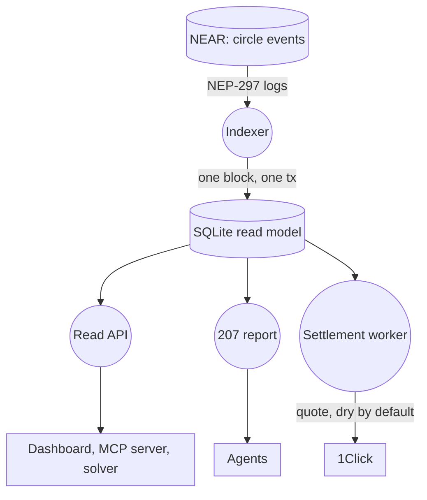

# x207 backend

The indexer, read API, HTTP `207` report and settlement worker of [x207](https://github.com/x207-labs/x207), plus the marketplace book and the access broker.

## Its role in x207

The [contract](https://github.com/x207-labs/contracts) emits NEP-297 events; the backend turns them into a SQLite read model that everything else queries. The [dashboard](https://github.com/x207-labs/frontend) and the [solver](https://github.com/x207-labs/solver) read it, the [SDK](https://github.com/x207-labs/sdk) and its MCP server call it, and the HTTP `207 Multi-Status` report tells a payer which of its payments cleared. The indexer halts and writes nothing when its state does not match the chain; it never fixes data silently.



| Folder | Contents |
| --- | --- |
| `src/indexer/` | NEP-297 event indexer for the `x207-circle` contract |
| `src/api/` | Read API |
| `src/report207/` | HTTP `207 Multi-Status` report |
| `src/settlement/` | Residual worker: `deposit`, `withdraw`, `claims` (holds no keys) |
| `src/db/` | SQLite schema and migrations |
| `broker/` | Access broker (leases, grants) |

## Try it

The read API of the testnet circle `x207-v013.testnet` runs on a boxd machine, GET only, with no signing key and no settlement endpoints:

```bash
curl -s https://x207.boxd.sh/healthz
curl -s https://x207.boxd.sh/x207/circles/agents-main/epochs/8/metrics
```

CORS is open for `https://x207.vercel.app` only. It runs on the boxd machine `x207` (UM-148): [deploy/boxd](https://github.com/x207-labs/x207/blob/main/deploy/boxd/README.md). The Railway setup it replaced is kept for the record in [`deploy/railway/README.md`](deploy/railway/README.md).

## Run and test

Node ≥ 22.22.2.

```bash
npm install
npm run build
npm test
```

To run it: fill in `.env` (names in `.env.example`: `NEAR_RPC_PRIMARY_URL`, `X207_CONTRACT_ID`, `X207_START_BLOCK`, `X207_SETTLEMENT_MODE`, default `dry`), then `npm run build && npm start`. `src/main.ts` runs the indexer, the read API, the settlement endpoints and the job monitor in one process. `.env` is never committed.

CI runs at the umbrella workspace (`.github/workflows/ci-node-workspace.yml` in `x207-labs/x207`), because `@x207/core` resolves from `sdk/packages/core` there; on its own, use the install above.

## Evidence

- **Read model against the real circle:** `scripts/testnet-v013.mjs` runs the real indexer from the first transaction of `x207-v013.testnet` and compares the read model with the contract views (members, epochs, obligations, cleared edges, positions, fees). It reads blocks and views only, sends nothing, uses no key:

  ```bash
  READMODEL_DB=/tmp/x207-testnet-v013.sqlite node scripts/testnet-v013.mjs x207-v013.testnet > report.json
  ```

  The free neardata endpoint is slow (500 blocks take 8 to 10 minutes). A recorded run: [docs/testnet-v013.md](docs/testnet-v013.md).
- **Live quote, no funds move:** `POST /x207/settlement/withdraw/quote` asks 1Click for a price. With `X207_SETTLEMENT_MODE=dry` (default) the call is always `dry: true`; `submit` needs `live` and answers `422 live_mode_disabled` otherwise. A recorded answer (5 credit to USDC on Base, 2026-11-04) is in [docs/reference.md](docs/reference.md#live-quote-of-1click-be-090).
- **Restart safety:** one block is one SQLite transaction, so a `SIGKILL` leaves the file as it was before that block. Tests in `test/indexer/resilience.test.ts`.
- **OpenAPI 3.1:** `docs/openapi.json`, generated from the routes (`npm run openapi`); a test fails when router and document differ.
- **Limits, health, metrics, logs:** per-IP and per-account rate limits (in memory of one process, so two instances count separately), `GET /healthz`, `GET /metrics`, JSON logs that never carry a path, query, body or secret: [docs/reference.md](docs/reference.md).

More: [operations](docs/operations.md) · [testnet read model](docs/testnet-readmodel.md) · [security findings](docs/security-findings.md).

## Back to x207

Overview, live demo links and the claims map: [x207-labs/x207](https://github.com/x207-labs/x207).

## License

Apache-2.0
