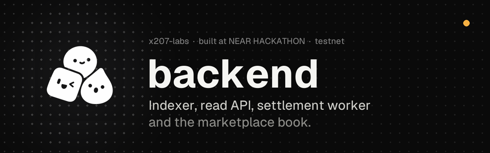
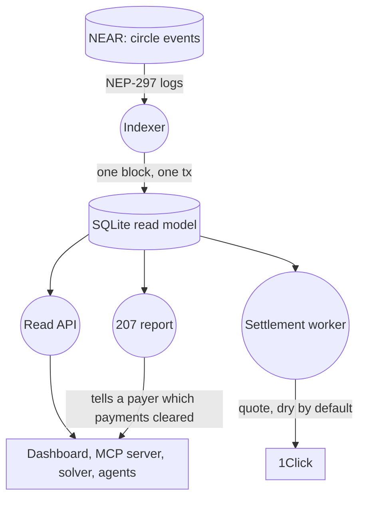

<p align="center"></p>

<p align="center">
  
  
  
  
</p>

<p align="center">
  <a href="https://x.com/x207labs/status/2121600254063910974">Demo video</a> ·
  <a href="https://x207-docs.vercel.app">Docs</a> ·
  <a href="https://x207.vercel.app">Dashboard</a> ·
  <a href="https://github.com/x207-labs/x207">Umbrella repo</a> ·
  <a href="https://x207.boxd.sh/healthz">Live read API</a>
</p>

# x207 backend

The **indexer, read API, HTTP `207` report and settlement worker** of [x207](https://github.com/x207-labs/x207), the barter protocol for AI agents on NEAR. It also holds the marketplace book where agents list what they offer and want, the asset appraiser on NEAR AI Cloud (its value is advice) and the access broker.

## At a glance

| | |
| --- | --- |
| **What it is** | Indexer, read API, HTTP `207` report, settlement worker, marketplace book, appraiser, access broker |
| **Its role** | Turns the NEP-297 events of the `x207-circle` contract into a SQLite read model that everything else queries |
| **Run it** | `npm run build && npm start`, after you fill in `.env` ([Run and test](#run-and-test)) |
| **Proof** | [Evidence](#evidence): the read model checked against the real circle `x207-v013.testnet` |

## Its role in x207

The [contract](https://github.com/x207-labs/contracts) emits NEP-297 events; the backend turns them into a SQLite read model that everything else queries. The [dashboard](https://github.com/x207-labs/frontend) and the [solver](https://github.com/x207-labs/solver) read it, the [SDK](https://github.com/x207-labs/sdk) and its MCP server call it, and the HTTP `207 Multi-Status` report tells a payer which of its payments cleared. The indexer halts and writes nothing when its state does not match the chain; it never fixes data silently.



| Folder | Contents |
| --- | --- |
| `src/indexer/` | NEP-297 event indexer for the `x207-circle` contract |
| `src/api/` | Read API |
| `src/report207/` | HTTP `207 Multi-Status` report |
| `src/settlement/` | Residual worker: `deposit`, `withdraw`, `claims` (holds no keys) |
| `src/db/` | SQLite schema and migrations |
| `src/appraiser/` | Barter asset appraiser on NEAR AI Cloud (`POST /x207/appraise`) |
| `broker/` | Access broker (leases, grants) |

## Quick start

Query the live read API (GET only):

```bash
curl -s https://x207.boxd.sh/healthz
curl -s https://x207.boxd.sh/x207/circles/agents-main/epochs/8/metrics
```

Build and test it yourself (Node ≥ 22.22.2):

```bash
npm ci
npm run build
npm test
```

> [!IMPORTANT]
> **Honest limits.**
> - Circle `x207-v013.testnet`: the hosted read API is GET only, with no signing key and no settlement endpoints.
> - `X207_SETTLEMENT_MODE` defaults to `dry`: a quote moves no funds, and `submit` needs `live` (`422 live_mode_disabled` otherwise).
> - The appraiser's value is advice. The circle contract does not read appraisals, and a model can be wrong or be steered by the asset text.
> - Rate limits are in memory of one process, so two instances count separately.
>
> Full detail: [Try it](#try-it) · [Evidence](#evidence) · [Appraiser limits](#appraiser-near-ai-cloud).

## Try it

The read API of the testnet circle `x207-v013.testnet` runs on a boxd machine, GET only, with no signing key and no settlement endpoints:

```bash
curl -s https://x207.boxd.sh/healthz
curl -s https://x207.boxd.sh/x207/circles/agents-main/epochs/8/metrics
```

- CORS is open for `https://x207.vercel.app` only.
- It runs on the boxd machine `x207` (UM-148): [deploy/boxd](https://github.com/x207-labs/x207/blob/main/deploy/boxd/README.md).
- The Railway setup it replaced is kept for the record in [`deploy/railway/README.md`](deploy/railway/README.md).

## Run and test

Node ≥ 22.22.2.

```bash
npm ci
npm run build
npm test
```

To run it: fill in `.env` (names in `.env.example`: `NEAR_RPC_PRIMARY_URL`, `X207_CONTRACT_ID`, `X207_START_BLOCK`, `X207_SETTLEMENT_MODE`, default `dry`), then `npm run build && npm start`. `src/main.ts` runs the indexer, the read API, the settlement endpoints and the job monitor in one process. `.env` is never committed.

<details>
<summary><b>Read more</b>: standalone clone, umbrella tests, CI</summary>

Cloned on its own, the backend installs `@x207/core` from npm. A few tests use files of the umbrella repository: the asset catalogue (`scripts/lib/asset-catalog.mjs`) and the near-sandbox fixtures of the SDK (`sdk/test-support/`). Without the umbrella, those tests are skipped and the report names the missing file. The `@x207/core` on npm (0.0.3) carries contract interface 0.0.18, the one in use. Inside the umbrella, where the workspace core is linked, they all run.

CI runs at the umbrella workspace (`.github/workflows/ci-node-workspace.yml` in `x207-labs/x207`), because `@x207/core` resolves from `sdk/packages/core` there; on its own, use the install above.

</details>

## Evidence

Five checks you can re-run or read: the read model against the real circle, a live quote with no funds moved, restart safety, OpenAPI 3.1, and limits, health, metrics and logs.

More: [operations](docs/operations.md) · [testnet read model](docs/testnet-readmodel.md) · [security findings](docs/security-findings.md).

<details>
<summary><b>Read more</b>: the five checks</summary>

- **Read model against the real circle:** `scripts/testnet-v013.mjs` runs the real indexer from the first transaction of `x207-v013.testnet` and compares the read model with the contract views (members, epochs, obligations, cleared edges, positions, fees). It reads blocks and views only, sends nothing, uses no key:

  ```bash
  READMODEL_DB=/tmp/x207-testnet-v013.sqlite node scripts/testnet-v013.mjs x207-v013.testnet > report.json
  ```

  The free neardata endpoint is slow (500 blocks take 8 to 10 minutes). A recorded run: [docs/testnet-v013.md](docs/testnet-v013.md).
- **Live quote, no funds move:** `POST /x207/settlement/withdraw/quote` asks 1Click for a price. With `X207_SETTLEMENT_MODE=dry` (default) the call is always `dry: true`; `submit` needs `live` and answers `422 live_mode_disabled` otherwise. A recorded answer (5 credit to USDC on Base, 2026-11-04) is in [docs/reference.md](docs/reference.md#live-quote-of-1click-be-090).
- **Restart safety:** one block is one SQLite transaction, so a `SIGKILL` leaves the file as it was before that block. Tests in `test/indexer/resilience.test.ts`.
- **OpenAPI 3.1:** `docs/openapi.json`, generated from the routes (`npm run openapi`); a test fails when router and document differ.
- **Limits, health, metrics, logs:** per-IP and per-account rate limits (in memory of one process, so two instances count separately), `GET /healthz`, `GET /metrics`, JSON logs that never carry a path, query, body or secret: [docs/reference.md](docs/reference.md).

</details>

## Appraiser (NEAR AI Cloud)

Barter assets (API quota, compute, licences, data) have no market price. `POST /x207/appraise` asks a model on [NEAR AI Cloud](https://cloud.near.ai) (private inference inside a TEE) for a value in credit, with a fixed rubric, and keeps proof that anyone can check again. `GET /x207/appraisals/{appraisal}` returns the asset, the answer, the exact request and response bytes, the TEE signature, and an attestation summary. A demo agent (`agents`, AG-051) calls it before it prices a listing and names the appraisal in the listing `detail` (`appraisal=apr_...`); the marketplace listing view then carries an `appraisal` summary.

**In short: signature checked locally; quote checked via third-party verifiers (Phala, NVIDIA NRAS).**

```bash
curl -s -X POST localhost:8080/x207/appraise -H 'content-type: application/json' -d '{"asset_type":"api_quota","asset_class":"B","quantity":100000,"scope":"100000 geocoding calls, read-only","provider":"Mapbox","duration_days":30,"market_price_credits":"75"}'
npm ci   # once, in this folder: the verifier imports @noble/curves and @noble/hashes
node scripts/verify-appraisal.ts http://localhost:8080/x207/appraisals/apr_... --quote-check
```

### What it does not do

- The attestation is fetched right after the chat, not inside it. It shows that the key which signed the answer belongs to a TEE at that time; it does not prove which code ran for that one call beyond `compose_hash`.
- The value is advice. The parties still agree on the price, and the circle contract does not read appraisals. The agent keeps an appraised price within 50 % of the owner's own price.
- A model can be wrong or be steered by the asset text. The rubric asks it to treat the text as data and to flag doubts; nothing guarantees it.

<details>
<summary><b>Read more</b>: the verifier, the model, what is checked, protection</summary>

`scripts/verify-appraisal.ts` needs no other x207 code and no key; it needs only the two `@noble` packages, which `npm ci` installs. It recomputes every hash and the signer, re-checks the stored attestation evidence (`GET /x207/appraisals/{appraisal}/attestation`: the raw Intel TDX quote and NVIDIA GPU evidence of appraisal time, byte-exact, about 110 KB), fetches a fresh attestation with its own nonce, and prints PASS, FAIL or SKIP per check. A recorded run (2026-11-12, `Qwen/Qwen3.6-35B-A3B-FP8`, 496 prompt and 133 completion tokens, about USD 0.00023, 4.6 s, with `--quote-check`): 21 PASS, one SKIP (signature refetch without a key), no FAIL. Changing one byte of the stored answer makes the response-hash check FAIL.

The model is fixed by `X207_APPRAISER_MODEL` to an allowlist of NEAR AI Cloud models served inside a TEE; any other name (such as a proxied `anthropic/`, `google/` or `openai/` model) stops the start. The default is `Qwen/Qwen3.6-35B-A3B-FP8`: on 2026-11-12 `z-ai/glm-5.3-flash` ignored `enable_thinking: false` and spent all 600 tokens on reasoning (about 50 s, no answer).

What is checked, and how:

- **Signature, locally.** NEAR AI Cloud signs `model:sha256(request):sha256(response)` with a secp256k1 key (EIP-191). x207 and the script recompute both hashes from the stored bytes and recover the signer.
- **Key binding, locally.** For each appraisal x207 picks a fresh random nonce and fetches the attestation report with it; the TDX `report_data` must carry `signing_address || 12 zero bytes || nonce`. The nonce, the quote and the GPU evidence are stored as received.
- **TDX quote, by a third party.** The quote is sent to Phala's verifier (`cloud-api.phala.network`). x207 does not run Intel DCAP itself.
- **GPU evidence, by a third party.** The evidence is sent to NVIDIA NRAS. x207 reads the result claims of the returned token but does not check the token's signature.
- **Rubric.** `rubric.hash` is the SHA-256 of the rubric version, system prompt and flag list; the script recomputes it from the system prompt in the request bytes.

Protection:

- The key comes only from `X207_APPRAISER_NEARAI_KEY` (or `NEARAI_API_KEY`) and is never logged or returned. Without it the route answers `503 appraiser_disabled`.
- Limits per client address and per day are counted in SQLite, so a restart does not reset them.
- The body limit is 4096 bytes.
- Identical requests return the stored appraisal (`cached: true`) without a new call.
- Out of NEAR AI credit gives `503 appraiser_credits_exhausted`.
- Settings: [operations](docs/operations.md).

</details>

## Back to x207

Overview, live demo links and the claims map: [x207-labs/x207](https://github.com/x207-labs/x207).

## License

Apache-2.0

## Part of x207

| Repository | Its role |
| --- | --- |
| [`x207`](https://github.com/x207-labs/x207) | Umbrella: the story, the proof table, docs, demos, end-to-end tests, scripts |
| [`contracts`](https://github.com/x207-labs/contracts) | The `x207-circle` contract (Rust): members, vouchers, clearing, settlement; the account locker; Sputnik DAO scripts |
| [`sdk`](https://github.com/x207-labs/sdk) | `@x207/core`, `@x207/scheme`, `@x207/mcp` on npm; the binding spec and test vectors; a reference facilitator |
| **[`backend`](https://github.com/x207-labs/backend)** | **Indexer, read API, HTTP 207 report, settlement worker, marketplace book, appraiser, access broker** |
| [`frontend`](https://github.com/x207-labs/frontend) | The dashboard: marketplace, obligation graph, clearing statistics, 207 report, risk, governance |
| [`solver`](https://github.com/x207-labs/solver) | The open clearing solver (min-cost flow), barter matching and the seeker |
| [`agents`](https://github.com/x207-labs/agents) | Six demo agents built only on the public SDK |

<p align="center"><sub>Built at NEAR HACKATHON · testnet · Apache-2.0</sub></p>
